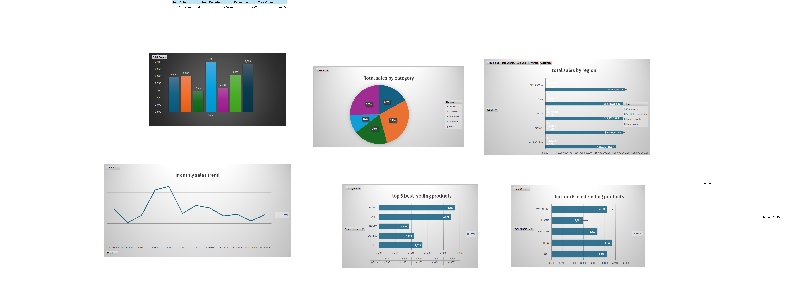

# Sales Dashboard: Excel Power Query, Data Model & Interactive Dashboard

An end-to-end BI project built entirely in Microsoft Excel:

1. **ETL with Power Query (M):** combining a folder of monthly order files and cleaning the Orders, Products and Customers sources.
2. **Data modeling with Power Pivot:** a star schema with a Calendar table, relationships and DAX measures.
3. **Reporting:** pivot tables and pivot charts feeding an interactive dashboard.

---

## Project Overview

| Item | Details |
|------|---------|
| **Tool** | Microsoft Excel (Power Query, Power Pivot, PivotTables, Slicers) |
| **Language** | Power Query M, DAX |
| **Sources** | Folder of monthly order CSVs, `Products.csv`, `Customers.csv` |
| **Model** | Star schema: fact table `Orders` + dimensions `Products`, `Customers`, `Calendar` |

## Repository Structure

```
.
├── README.md
├── Sales-Dashboard.xlsx
├── Orders.m          (Power Query: combine folder, fix dates, new OrderID)
├── Products.m        (Power Query: dedupe, clean text, fix price)
├── Customers.m       (Power Query: dedupe, clean names and regions)
├── measures.dax      (DAX measures)
├── data-model.png
└── dashboard.png
```

> **Note:** the `Source` paths inside the `.m` files point to the author's computer. Update them before refreshing.

## Data Sources

| Source | Columns |
|--------|---------|
| `Orders/` (monthly CSV files, e.g. `Orders_1.csv`) | `OrderID`, `CustomerID`, `ProductID`, `OrderDate`, `Quantity` |
| `Products.csv` | `ProductID`, `ProductName`, `Category`, `Price` |
| `Customers.csv` | `CustomerID`, `CustomerName`, `Region` |

## Data Quality Issues Found & Fixes

| Table | Issue | Fix |
|-------|-------|-----|
| Orders | Data split across many monthly files | Folder combine with a *Transform File* function |
| Orders | Missing `ProductID` / `Quantity` | Filtered out null rows |
| Orders | Mixed date formats (`/` and `-`, day/month/year order varies) | Normalized separators, split into parts, rebuilt Year / Month / Day (month taken from the file name) into a real `date` |
| Orders | `OrderID` unreliable after cleaning | Dropped and regenerated with an Index column |
| Products | Duplicate `ProductID`s | `Table.Distinct` on `ProductID` |
| Products | Inconsistent casing and extra spaces | `Text.Proper` + `Text.Trim` |
| Products | Price stored as text (`$`, "Two Hundred") | Replaced text, removed `$`, converted to **Currency** |
| Customers | Duplicate `CustomerID`s | `Table.Distinct` on `CustomerID` only |
| Customers | Messy casing and spaces in names / regions (e.g. "Ca Iro") | Trim, Proper case, removed spaces from `Region` |

## Power Query Steps

Full M code: [Orders.m](Orders.m), [Products.m](Products.m), [Customers.m](Customers.m).

- **Orders:** combine folder, filter nulls, normalize date separators, split date into parts, find Year (part >= 2000), Month (from file name), Day (first valid day that is not the month), rebuild with `#date(Year, Month, Day)`, regenerate `OrderID`.
- **Products:** remove duplicates, Proper + Trim, clean `Price`, set type to Currency.
- **Customers:** Trim + Proper on name, clean `Region`, remove duplicates on `CustomerID`.

## Data Model (Star Schema)


| Relationship | Type |
|--------------|------|
| `Products[ProductID]` → `Orders[ProductID]` | One-to-many |
| `Customers[CustomerID]` → `Orders[CustomerID]` | One-to-many |
| `Calendar[Date]` → `Orders[OrderDate]` | One-to-many |

**Calendar table columns:** `Date`, `Year`, `Month Number`, `Month`, `MMM-YYYY`, `Day Of Week Number`, `Day Of Week`.

**DAX measures** ([measures.dax](measures.dax)):

| Measure | Purpose |
|---------|---------|
| `Total Sales` | Revenue (quantity × product price) |
| `Total Quantity` | Total units sold |
| `Customers` | Number of distinct customers |
| `Avg Sales Per Order` | Average revenue per order |
| `Total Orders` | Number of orders |

## Dashboard



**KPIs:** Total Sales **$101,208,243.09** · Total Quantity **108,203** · Customers **300** · Total Orders **19,606**

**Visuals:** total sales by category (pie), total sales by region (bar), monthly sales trend (line), orders by day of week (column), top 5 best-selling products and bottom 5 least-selling products (bar).

**Interactivity:** slicers and pivot charts driven by the Data Model.

## How to Reproduce

1. Download this repository.
2. In Excel: **Data → Get Data → Launch Power Query Editor**.
3. For each table create a Blank Query, open the Advanced Editor and paste the code from the `.m` files.
4. Update the `Source` paths to your own folder and file locations.
5. **Close & Load** with *Add this data to the Data Model*.
6. In Power Pivot, create the Calendar table, the relationships, and the measures from `measures.dax`.
7. Build the pivot tables from the Data Model and add slicers.

## Skills Demonstrated

Power Query (M), combining files from a folder, handling inconsistent date formats, deduplication and text cleaning, star schema modeling, Calendar table, DAX measures, pivot tables and charts, slicers, dashboard design.

## Author

**[Your Name]**
